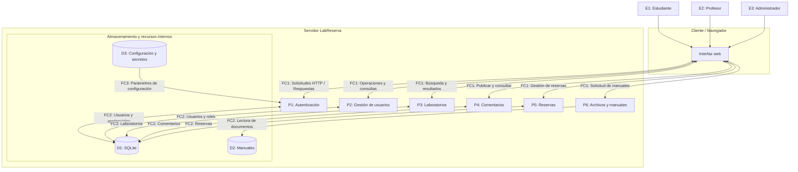

# Diagrama de Flujo de Datos (DFD) — LabReserva

## Parte A: Modelado de amenazas

El siguiente diagrama representa los componentes principales de LabReserva, los flujos de información y las fronteras de confianza identificadas durante el análisis inicial.

El DFD fue elaborado a partir del README y la exploración de la aplicación, sin inspeccionar el código fuente.

## Diagrama

## Elementos representados

| Identificador | Tipo | Descripción |
|---|---|---|
| E1–E3 | Entidades externas | Estudiantes, profesores y administradores. |
| P1–P6 | Procesos | Funcionalidades lógicas de LabReserva. |
| D1 | Almacén de datos | Base de datos SQLite con usuarios, laboratorios, comentarios y reservas. |
| D2 | Almacén de archivos | Manuales disponibles en el servidor. |
| D3 | Configuración | Variables y secretos utilizados internamente. |
| FC1 | Frontera de confianza | Separación entre navegador y servidor. |
| FC2 | Frontera lógica | Acceso de los procesos a datos y archivos. |
| FC3 | Frontera de confianza | Acceso a configuración y secretos internos. |

## Consideraciones de seguridad

- Las solicitudes provenientes del navegador deben considerarse no confiables.
- La autenticación no sustituye la autorización sobre cada recurso.
- Las operaciones sobre SQLite deben validar los permisos correspondientes.
- Las solicitudes de archivos deben limitarse a los documentos permitidos.
- La configuración y los secretos no deben exponerse a los usuarios.

Este modelo es preliminar y se utilizará para analizar las hipótesis STRIDE documentadas en `01-modelado-amenazas.md`.
